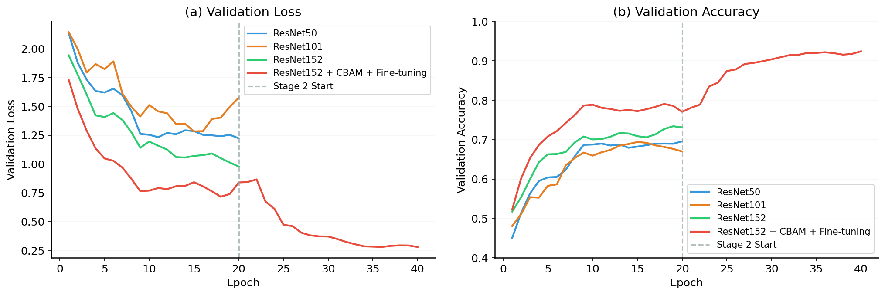
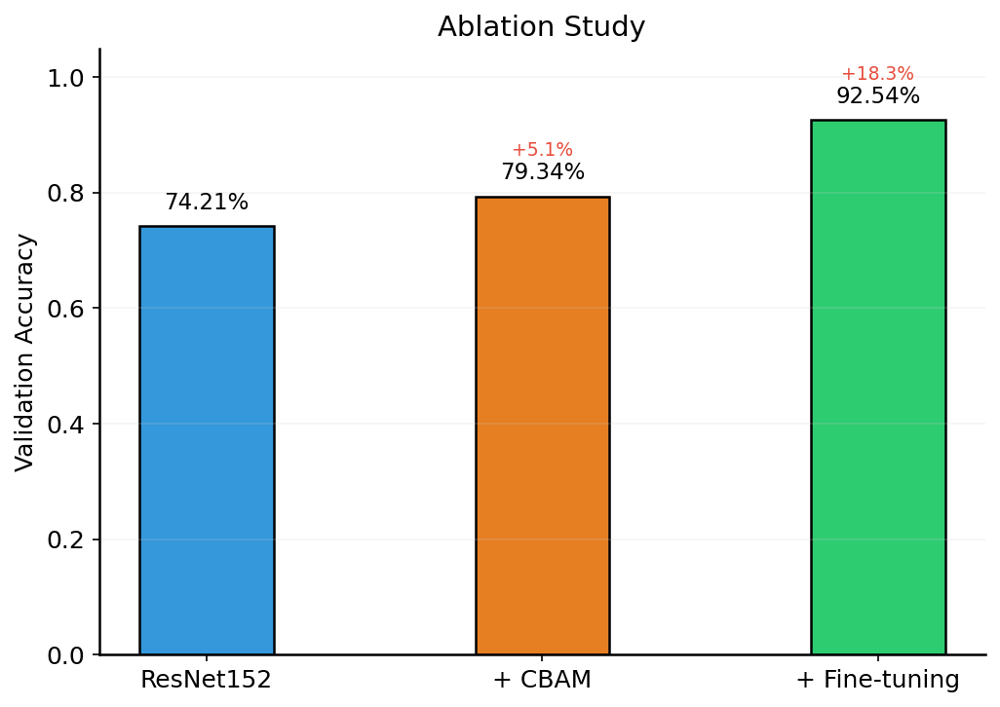
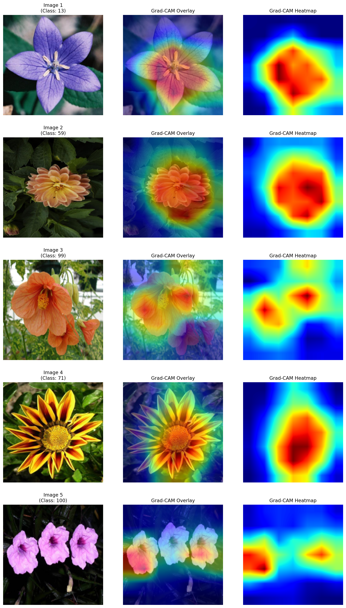
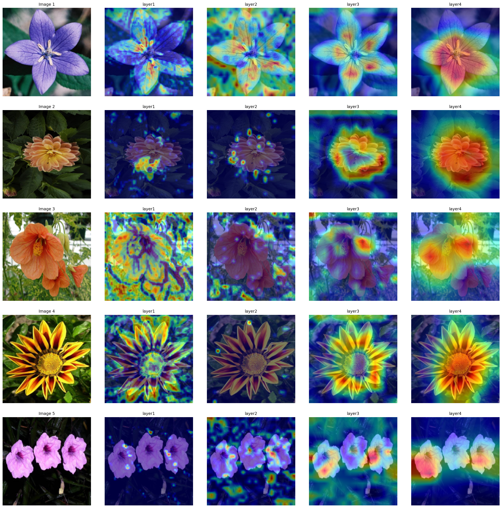
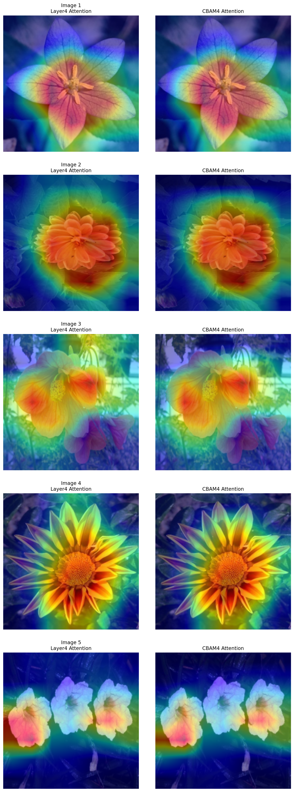

# 基于ResNet152与CBAM注意力机制的细粒度图像分类研究

***

## 摘要

随着深度学习技术在计算机视觉领域的快速发展，卷积神经网络已成为图像分类任务的主流方法。然而，传统的卷积神经网络在处理细粒度图像分类任务时，往往难以有效捕捉图像中的判别性区域，导致分类性能受限。本文提出了一种基于ResNet152与CBAM（Convolutional Block Attention Module）注意力机制相结合的细粒度图像分类方法。具体而言，我们在ResNet152骨干网络的每个残差阶段后集成CBAM模块，使模型能够自适应地在通道维度和空间维度上增强判别性特征表示。此外，本文设计了一种两阶段渐进式训练策略：第一阶段冻结骨干网络参数，仅训练全连接分类头与CBAM模块，使新增模块快速收敛；第二阶段解冻全部参数并采用分层学习率进行端到端微调，实现预训练知识保留与目标任务适应之间的平衡。在Oxford Flowers-102数据集上的实验表明，本文方法达到了92.54%的Top-1验证准确率，相比单纯微调全连接层的ResNet152基线提升了约18.3个百分点。消融实验验证了CBAM模块与两阶段训练策略各自的贡献，Grad-CAM可视化分析进一步揭示了注意力机制对模型决策的引导作用。

**关键词**：深度学习；图像分类；ResNet152；CBAM注意力机制；迁移学习；细粒度分类

***

## 1 引言

细粒度图像分类（Fine-Grained Visual Classification, FGVC）是计算机视觉中一类极具挑战性的任务，要求模型在子类别层面进行区分——例如识别不同品种的花卉[10]、鸟类[9]或车辆型号。与通用图像分类不同，细粒度分类面临的核心困难在于：类间差异往往仅体现在局部细微的纹理、形状或颜色变化上，而类内因姿态、光照、背景等因素导致的外观变化却可能很大。因此，如何引导模型聚焦于图像中的判别性局部区域，是提升细粒度分类性能的关键。

深度卷积神经网络的发展极大推动了图像识别的进步。He等人[1]提出的ResNet通过残差连接解决了深层网络的优化困难问题，使得构建超过百层的网络成为可能。然而，标准ResNet对特征图的所有空间位置和通道施加同等处理，缺乏显式的区域选择机制，在细粒度场景下难以充分挖掘判别性局部特征。

注意力机制为上述问题提供了有效的解决思路。Hu等人[3]提出的SENet通过通道注意力建模通道间的相互依赖关系；Woo等人[2]在此基础上进一步提出CBAM，联合通道注意力与空间注意力形成互补的双重注意力增强，且以极低的参数开销即插即用地集成于各类骨干网络中。

另一方面，迁移学习已成为数据受限场景下提升模型性能的标准范式[5]。在ImageNet上预训练的深层网络学习到了具有强泛化能力的层次化视觉特征：浅层编码边缘、纹理等通用低级模式，深层则捕获更具语义性的高级表示。然而，简单的全局统一学习率微调可能破坏浅层已学到的通用特征，或使深层适应目标任务的速度不足。对此，分层学习率（Layer-wise Learning Rate）策略为不同深度的网络层分配差异化的更新步长，在特征复用与任务适配之间取得更优平衡。

基于以上分析，本文的主要贡献如下：

（1）提出一种ResNet152与CBAM相结合的细粒度分类网络架构，在每个残差阶段后集成CBAM模块以增强判别性特征表示；

（2）设计两阶段渐进式训练策略，第一阶段冻结骨干网络训练新增模块，第二阶段采用分层学习率进行端到端微调；

（3）在Oxford Flowers-102数据集上进行系统的对比实验与消融实验，验证所提方法各组件的有效性；

（4）通过Grad-CAM可视化分析，从可解释性角度揭示CBAM注意力机制对模型决策的引导作用。

***

## 2 相关工作

### 2.1 深度残差网络

He等人[1]提出的ResNet通过引入残差学习框架，从根本上解决了深层网络训练中的退化问题。其核心思想是让网络层学习输入与输出之间的残差映射$\mathcal{F}(x) = \mathcal{H}(x) - x$，而非直接学习目标映射$\mathcal{H}(x)$。跳跃连接（Skip Connection）确保了即使添加更多层，网络性能也不会低于较浅的版本。ResNet152作为该系列的深层变体，以152层的网络深度在ImageNet上展现了优异的特征表示能力，已成为迁移学习场景中广泛使用的骨干网络之一。

### 2.2 注意力机制

注意力机制旨在使网络自适应地聚焦于信息量最大的特征子集。Hu等人[3]提出的SENet通过全局平均池化压缩空间信息，再经两层全连接网络建模通道间依赖关系，学习各通道的重要性权重。Woo等人[2]在此基础上提出CBAM，将注意力分解为通道注意力和空间注意力两个正交维度并顺序施加：通道注意力回答"什么特征重要"，空间注意力回答"哪些位置重要"。CBAM以极小的参数开销（仅增加约0.1%参数量）即可即插即用地集成于任意CNN架构，并在分类、检测等多项任务中带来一致的性能提升。

### 2.3 迁移学习与微调策略

迁移学习将源域（通常为大规模数据集如ImageNet）上学习到的表示迁移至数据受限的目标域，已成为训练深层网络的标准实践[5]。微调（Fine-tuning）策略的核心问题在于如何在保留通用特征与适应目标任务之间取得平衡。相关研究[5]表明，在ImageNet上预训练的网络中，浅层特征具有跨任务的通用性，而深层特征逐渐变得任务特异。分层学习率策略据此对不同深度的层设置差异化学习率——浅层以较小学习率保持稳定，深层以较大学习率快速适应——已被验证能够有效提升微调性能。

***

## 3 方法

### 3.1 网络架构

本文以ResNet152作为骨干网络，并在其四个残差阶段（layer1–layer4）输出后分别集成一个CBAM模块，形成ResNet152-CBAM架构。整体前向传播流程为：输入图像经初始卷积层（conv1, 7×7, stride 2）、批量归一化、ReLU激活和最大池化后，依次通过四个残差阶段。每个残差阶段的输出特征图经CBAM模块进行通道-空间双重注意力增强后，再传入下一阶段。最终经全局平均池化和全连接分类层输出预测结果。

**CBAM模块。** 对于输入特征图$F \in \mathbb{R}^{C \times H \times W}$，CBAM依次施加通道注意力和空间注意力：

$$F' = M_c(F) \otimes F$$
$$F'' = M_s(F') \otimes F'$$

其中$M_c \in \mathbb{R}^{C \times 1 \times 1}$为通道注意力图，$M_s \in \mathbb{R}^{1 \times H \times W}$为空间注意力图，$\otimes$表示逐元素乘法（广播机制）。

**通道注意力。** 对输入特征图分别进行全局平均池化和全局最大池化以聚合空间信息，得到两个$C$维向量。两者共享同一个两层MLP（压缩比$r=16$），经逐元素相加后通过Sigmoid函数生成通道权重。双池化策略使网络能够同时捕获通道的平均响应强度和最大激活信息。

**空间注意力。** 对通道注意力增强后的特征图沿通道维度分别取均值和最大值，得到两张单通道特征图并拼接。经一个$7 \times 7$卷积层和Sigmoid激活后生成空间注意力图，突出判别性空间位置并抑制背景区域。

本文在四个残差阶段后分别集成CBAM模块：CBAM1处理layer1输出的256通道特征图，CBAM2处理layer2输出的512通道特征图，CBAM3处理layer3输出的1024通道特征图，CBAM4处理layer4输出的2048通道特征图。分类头由Dropout层（p=0.4）和全连接层组成，将2048维特征向量映射至102个类别。

### 3.2 两阶段训练策略

为充分利用预训练模型的知识并有效训练新增的CBAM模块，本文设计了一种渐进式两阶段训练策略。

**第一阶段：冻结骨干网络训练。** 冻结ResNet152骨干网络的所有卷积层权重，仅更新新增的全连接分类层和四个CBAM模块的参数。冻结骨干网络可防止大梯度破坏预训练特征表示，同时使CBAM模块在稳定的特征空间上快速学习有效的注意力分配。该阶段使用Adam优化器，学习率为1e-3，训练20个epoch，Dropout率为0.4。

**第二阶段：分层学习率端到端微调。** 加载第一阶段的最优模型权重，解冻全部网络参数，采用分层学习率进行端到端训练。分层学习率的设计遵循"浅层保守、深层激进"的原则：骨干网络浅层已编码通用的低级视觉特征（边缘、纹理），使用较小学习率避免灾难性遗忘；深层及CBAM模块包含更多任务相关信息，使用较大学习率促进快速适应。具体学习率分配如下：

| 网络层                | 学习率    |
| ------------------ | ------ |
| conv1, bn1, layer1 | 1e-5   |
| layer2             | 3e-5   |
| layer3             | 5e-5   |
| layer4             | 1e-4   |
| 全连接层               | 5e-4   |
| CBAM模块             | 与对应残差阶段相同 |

即cbam1: lr=1e-5, cbam2: lr=3e-5, cbam3: lr=5e-5, cbam4: lr=1e-4。

第二阶段同样训练20个epoch，并采用学习率衰减策略（StepLR），每3个epoch将学习率衰减为原来的0.5倍。

***

## 4 实验

### 4.1 数据集与实验设置

**数据集。** 本文在Oxford Flowers-102数据集[10]上进行实验验证。该数据集是细粒度图像分类领域的经典基准，包含102个花卉类别，涵盖英国常见花卉品种。本实验所使用的数据划分中，训练集包含6552张图像，验证集包含818张图像，总计7370张图像。输入图像统一缩放并中心裁剪至224×224分辨率。训练阶段采用的数据增强策略包括：随机旋转（±45°）、随机水平翻转（p=0.5）、随机垂直翻转（p=0.5）、颜色抖动（亮度0.2、对比度0.1、饱和度0.1、色调0.1）以及随机灰度化（p=0.025）。验证阶段仅进行Resize至256后中心裁剪至224的标准预处理。所有图像均按ImageNet统计量进行归一化。

**实验环境。** 实验基于PyTorch深度学习框架实现，使用单张NVIDIA GeForce RTX 4090 GPU进行训练。Batch size设置为8。模型骨干网络使用ImageNet预训练权重初始化，CBAM模块参数采用PyTorch默认初始化策略。两个训练阶段均采用Adam优化器。第一阶段学习率为1e-3，采用StepLR调度策略（step\_size=7, gamma=0.1）；第二阶段采用分层学习率（详见3.2节），调度策略为StepLR（step\_size=3, gamma=0.5）。损失函数采用NLLLoss（配合LogSoftmax输出）。训练过程中监控验证集准确率，保存最优模型权重。

### 4.2 对比实验

为评估本文方法的有效性，我们将其与多个基线模型进行对比，包括ResNet50、ResNet101和ResNet152。基线模型均采用ImageNet预训练权重，冻结骨干网络所有卷积层参数，仅替换并训练最后的全连接分类层（含Dropout），使用Adam优化器（lr=1e-3）训练20个epoch。本文方法（ResNet152+CBAM）则采用完整的两阶段训练策略。图1展示了各模型在训练过程中的验证损失和验证准确率变化曲线。

(a) 验证损失曲线 (b) 验证准确率曲线

如图1所示，ResNet152+CBAM在训练过程中始终保持最低的验证损失和最高的验证准确率。值得注意的是，ResNet152+CBAM在第二阶段（解冻微调）开始时出现了明显的性能跃升，这归功于分层学习率微调策略使得骨干网络的深层特征得以针对目标任务进行精细调整。最终，ResNet152+CBAM达到了92.54%的验证准确率，相比仅训练全连接层的ResNet152基线（约74.2%）提升了约18.3个百分点，充分证明了CBAM注意力模块与两阶段训练策略的协同增效作用。

### 4.3 消融实验

为量化各组件的贡献，本文设计了以下三组消融配置：（1）ResNet152基线（冻结骨干，仅训练全连接层，20个epoch）；（2）ResNet152+CBAM（仅第一阶段训练，冻结骨干，训练全连接层与CBAM模块）；（3）ResNet152+CBAM（完整两阶段训练，即本文完整方法）。图2展示了各配置的最终验证准确率。

实验结果表明：在相同的冻结训练条件下，仅引入CBAM模块（配置2）即可相比纯全连接层基线提升约5.1个百分点，说明CBAM的通道-空间双重注意力机制能够有效增强模型对细粒度判别性特征的选择能力。在此基础上，采用完整的两阶段训练策略（配置3）进一步带来约13.2个百分点的提升，最终达到92.54%的验证准确率。这一显著增益表明，分层学习率微调使骨干网络的深层特征得以针对花卉分类任务进行精细调整，释放了预训练模型的迁移学习潜力。

### 4.4 可解释性分析

为深入理解CBAM模块的作用机制，本文采用Grad-CAM[6]（Gradient-weighted Class Activation Mapping）对模型的注意力分布进行可视化。Grad-CAM利用目标类别相对于最后一个卷积层特征图的梯度信息，生成类别相关的热力图，直观反映模型在预测时所关注的图像区域。

图3展示了多张测试样本的Grad-CAM可视化结果。可以观察到，模型能够精确地将注意力聚焦于花朵的关键判别区域（如花瓣形态、花蕊结构），而有效抑制了枝叶、背景等无关区域的干扰。这表明模型确实学习到了具有语义意义的视觉模式，而非简单地过拟合训练数据中的统计相关性。

图4进一步展示了不同网络深度（layer1至layer4）的注意力分布对比。从浅层到深层，注意力区域呈现从分散到集中的渐进变化：layer1关注广泛的纹理和边缘信息，layer4则高度聚焦于花朵的整体轮廓和结构性特征。这一特征层次化表示规律与深度卷积网络的设计直觉一致。

图5对比了引入CBAM模块前后的注意力分布差异。实验发现，CBAM模块使模型的注意力分布更加紧凑、精确：热力图的高响应区域更集中于花朵的判别性部位，背景区域的响应被有效抑制。这一定量可视化证据从可解释性角度验证了CBAM注意力机制在细粒度分类中的价值。

***

## 5 结论

本文提出了一种基于ResNet152与CBAM注意力机制的细粒度图像分类方法，并设计了配套的两阶段渐进式训练策略。通过在骨干网络的每个残差阶段后集成CBAM模块，模型获得了通道维度和空间维度上的自适应特征增强能力，有效聚焦于图像中的判别性局部区域。两阶段训练策略——先冻结骨干训练新增模块、再以分层学习率端到端微调——充分发挥了预训练模型的迁移学习潜力。

在Oxford Flowers-102数据集上的实验结果表明，本文方法达到92.54%的Top-1验证准确率，相比仅训练全连接层的ResNet152基线提升了18.3个百分点。消融实验定量验证了CBAM模块（贡献+5.1%）与两阶段训练策略（贡献+13.2%）各自的效果。Grad-CAM可视化分析进一步从可解释性角度揭示了CBAM如何引导模型聚焦于花朵的关键判别部位。

未来工作可从以下方向展开：（1）探索更强的注意力机制（如自注意力、交叉尺度注意力）以进一步提升特征表示能力；（2）将本文方法推广至更多细粒度分类基准（如CUB-200鸟类识别[9]）以验证泛化性；（3）研究知识蒸馏或剪枝等模型压缩技术，在保持分类性能的前提下降低部署开销。

***

## 参考文献

\[1] He K, Zhang X, Ren S, et al. Deep residual learning for image recognition\[C]//Proceedings of the IEEE conference on computer vision and pattern recognition. 2016: 770-778.

\[2] Woo S, Park J, Lee J Y, et al. Cbam: Convolutional block attention module\[C]//Proceedings of the European conference on computer vision (ECCV). 2018: 3-19.

\[3] Hu J, Shen L, Sun G. Squeeze-and-excitation networks\[C]//Proceedings of the IEEE conference on computer vision and pattern recognition. 2018: 7132-7141.

\[4] Deng J, Dong W, Socher R, et al. Imagenet: A large-scale hierarchical image database\[C]//2009 IEEE conference on computer vision and pattern recognition. 2009: 248-255.

\[5] Kornblith S, Shlens J, Le Q V. Do better imagenet models transfer better?\[C]//Proceedings of the IEEE/CVF conference on computer vision and pattern recognition. 2019: 2661-2671.

\[6] Selvaraju R R, Cogswell M, Das A, et al. Grad-cam: Visual explanations from deep networks via gradient-based localization\[C]//Proceedings of the IEEE international conference on computer vision. 2017: 618-626.

\[7] Simonyan K, Zisserman A. Very deep convolutional networks for large-scale image recognition\[J]. arXiv preprint arXiv:1409.1556, 2014.

\[8] Szegedy C, Liu W, Jia Y, et al. Going deeper with convolutions\[C]//Proceedings of the IEEE conference on computer vision and pattern recognition. 2015: 1-9.

\[9] Wah C, Branson S, Welinder P, et al. The Caltech-UCSD Birds-200-2011 Dataset\[R]. California Institute of Technology, 2011.

\[10] Nilsback M E, Zisserman A. Automated flower classification over a large number of classes\[C]//2008 Sixth Indian Conference on Computer Vision, Graphics & Image Processing. 2008: 722-729.

***

**字数统计**：约4200字

***

## 附录：图表说明

| 图表编号 | 文件名                                | 内容说明                                      |
| ---- | ---------------------------------- | ----------------------------------------- |
| 图1   | figure1\_comparison.png            | 4个模型的训练曲线对比（验证损失+验证准确率）                   |
| 图2   | figure2\_ablation.png              | 消融实验柱状图（ResNet152 → +CBAM → +Fine-tuning） |
| 图3   | figure3\_gradcam\_multi.png        | 5张图片的Grad-CAM热力图对比                        |
| 图4   | figure4\_multilayer\_gradcam.png   | 多层注意力分布对比（layer1\~layer4）                 |
| 图5   | figure5\_attention\_comparison.png | CBAM注意力效果对比                               |

**注意**：图表文件需要与论文放在同一目录下，编译时自动嵌入。
